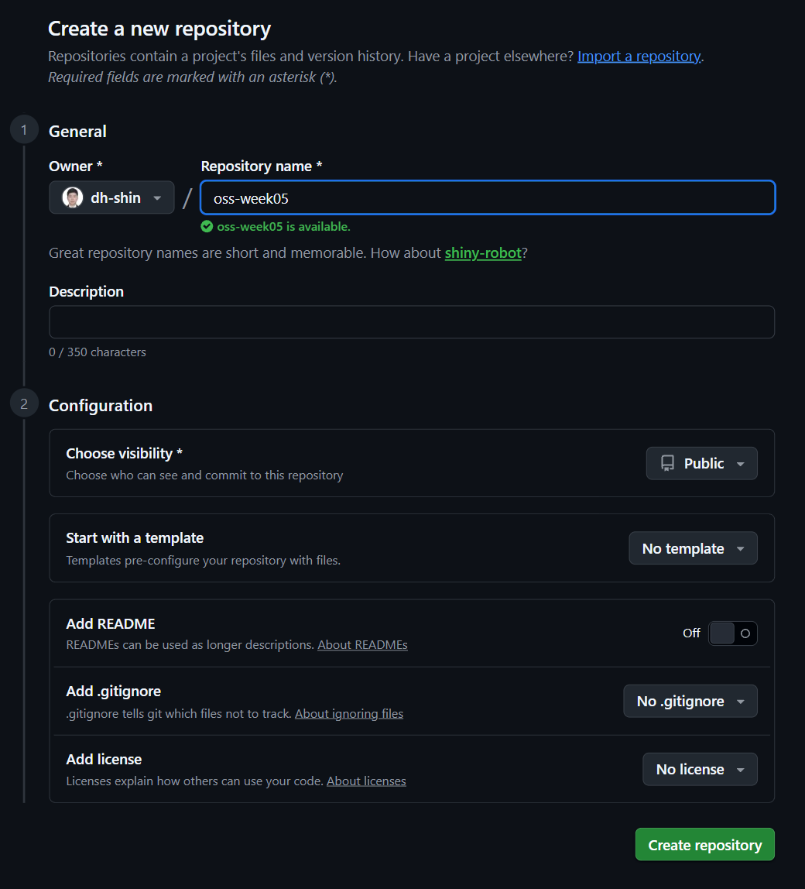
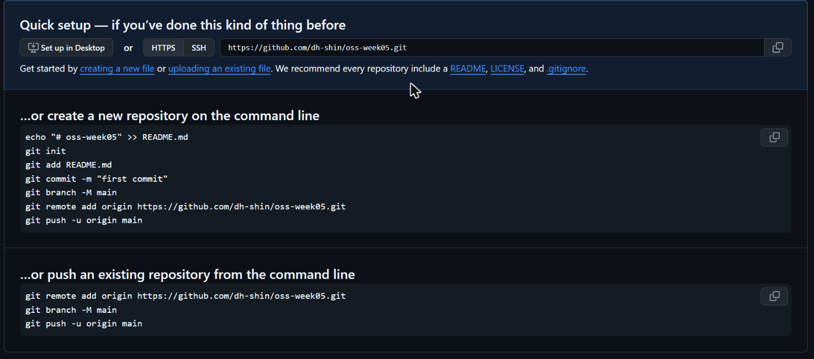
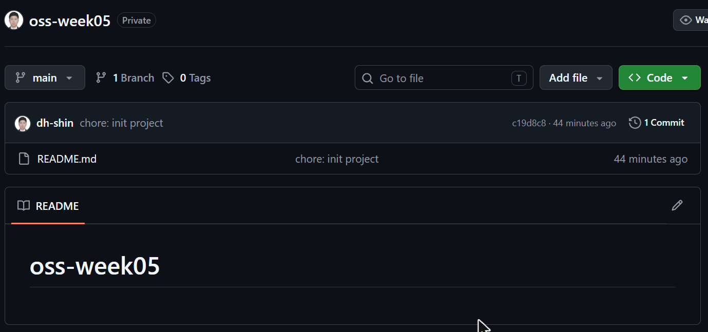

# P0. 처음부터 만들기 — `chore: init project`

지금까지는 GitHub 의 템플릿을 clone 해서 시작했습니다. 저장소(repository)를 만드는 일은 GitHub 이 (템플릿 버튼으로), 원격(remote, GitHub 쪽 저장소)에 연결하는 일은 Git 이 (`clone` 하면서) 대신 해 주었습니다.

이 문제에서 하는 것:
- 빈 폴더에서 저장소 만들기 (`git init`) → 첫 커밋
- GitHub 에 빈 저장소 만들기 → 둘을 연결 (`git remote add`) → 올리기 (`git push -u`)

끝나면 `origin` 이 무엇이고 어디서 오는지, `git push` 가 왜 아무 말 없이 되는지가 보입니다. 뒤의 P6·P7 에서 원격을 다룰 때 이 부분에 대한 이해가 필요합니다.

1. 빈 폴더 `oss-week05` 를 만들고 터미널(Git Bash)에서 그 안으로 들어갑니다.
2. `git init` → `.git` 폴더가 생겼는지 `ls -a` 로 확인.
3. 내 이름과 이메일이 Git 에 등록되어 있는지 확인합니다. 터미널에 아래를 칩니다.
   ```
   git config --list
   ```
   설정 항목이 한 줄에 하나씩 쭉 나옵니다(화면이 넘어가면 `q` 로 빠져나옵니다). 그중 `user.name=` 과 `user.email=` 으로 시작하는 두 줄을 찾습니다.
   ```
   user.name=Hong Gildong
   user.email=gildong@example.com
   ```
   이메일이 GitHub 에 등록한 것과 같으면 넘어갑니다. **두 줄이 없거나 다르면** 아래 두 줄을 본인 것으로 바꿔서 실행합니다.
   ```
   git config --global user.name "이름"
   git config --global user.email "GitHub에 등록한 이메일"
   ```
   다시 `git config --list` 를 쳐서 두 줄이 보이면 됩니다.
4. 기본 브랜치 이름을 확인합니다. `git status` 를 쳤을 때 첫 줄이 `On branch master` 라고 나오면, GitHub 의 기본 이름인 `main` 과 맞지 않습니다. 아래 두 줄을 실행합니다.
   ```
   git branch -M main
   git config --global init.defaultBranch main
   ```
   첫 줄은 지금 이 저장소의 브랜치 이름을 `main` 으로 바꾸고, 둘째 줄은 앞으로 만들 저장소도 처음부터 `main` 으로 시작하게 합니다. `On branch main` 이라면 이미 되어 있는 것이니 넘어갑니다.
5. `README.md` 를 만듭니다. 터미널에서 `code .` 을 치면 이 폴더가 VS Code 로 열립니다. 왼쪽 탐색기의 새 파일 아이콘(또는 `Ctrl+N` 뒤 `Ctrl+S`)으로 `README.md` 를 만들고, 첫 줄에 아래 한 줄을 적고 저장합니다.
   ```
   # oss-week05
   ```
   (터미널에서 한 번에 만들어도 됩니다: `echo '# oss-week05' > README.md`)
   `ls` 로 파일이 생겼는지 확인합니다.
6. 첫 커밋을 만듭니다. 다시 터미널로 돌아와서(VS Code 안의 터미널을 써도 됩니다: `` Ctrl+` ``) 두 줄을 차례로 칩니다.
   ```
   git add README.md
   git commit -m "chore: init project"
   ```
   `git log --oneline` 에 `chore: init project` 한 줄이 보이면 됩니다.
7. GitHub 에 빈 저장소를 만듭니다. 브라우저에서 github.com 에 로그인한 뒤:
   1. 오른쪽 위 **+** 버튼 → **New repository**. (또는 주소창에 `github.com/new`)
   2. **Repository name** 칸에 `oss-week05` 라고 정확히 입력합니다. (대소문자, 하이픈 그대로. 확인 스크립트가 이 이름을 찾습니다.) 아래에 초록색으로 `oss-week05 is available.` 이 뜨면 됩니다.
   3. **Choose visibility** 가 **Public** 인지 확인합니다.
   4. 나머지는 전부 기본값 그대로 둡니다: **Start with a template** = No template, **Add README** = **Off**, **Add .gitignore** = No .gitignore, **Add license** = No license. 특히 Add README 를 켜면 GitHub 쪽에 커밋이 하나 생겨서, 이미 커밋이 있는 내 로컬 저장소와 히스토리가 어긋나 첫 push 가 거부됩니다.
   5. 맨 아래 초록색 **Create repository** 버튼.

   

8. 저장소가 만들어지면 파일 목록 대신 **Quick setup** 안내 페이지가 뜹니다. GitHub 에 방금 만든 것은 **아직 커밋이 하나도 없는 빈 저장소**입니다. 실제 내용(README.md 와 첫 커밋)은 5·6번에서 만든 내 컴퓨터의 `oss-week05` 폴더에 있습니다. 그러니 지금 할 일은 GitHub 에서 뭔가를 새로 만드는 게 아니라, **내 로컬 저장소에 "네 원격은 저기다" 라고 알려 주고, 로컬 커밋을 그리로 올리는 것**입니다.
   안내 페이지에는 상자가 두 개 있습니다. 위 상자(`…or create a new repository on the command line`)는 로컬에 아무것도 없을 때 쓰는 것이니 무시하고, **아래 상자 `…or push an existing repository from the command line`** 의 세 줄을 터미널에 그대로 붙여 넣어 실행합니다. (`<ID>` 자리에는 본인 아이디가 이미 들어가 있습니다.)
   ```
   git remote add origin https://github.com/<ID>/oss-week05.git
   git branch -M main
   git push -u origin main
   ```

   

   세 줄이 각각 하는 일:
   - `git remote add origin <주소>` — 내 로컬 저장소에 원격 하나를 등록합니다. `origin` 은 그 원격에 붙이는 이름(별명)이고, 주소가 방금 만든 GitHub 저장소입니다. clone 으로 시작했을 때는 Git 이 이걸 자동으로 해 주지만, `init` 으로 시작했으니 직접 합니다.
   - `git branch -M main` — 지금 브랜치 이름을 `main` 으로 맞춥니다. 4번에서 이미 했으면 아무 일도 안 일어납니다.
   - `git push -u origin main` — 로컬 `main` 의 커밋을 `origin` 으로 올립니다. `-u` 는 "앞으로 이 브랜치의 짝은 `origin/main`" 이라고 기억시키는 옵션이라, 다음부터는 `git push` 만 쳐도 됩니다.
   처음 push 할 때 GitHub 로그인 창이 뜨면 브라우저로 로그인합니다.
9. `git remote -v` 로 `origin` 이 두 줄 나오는지 확인.
10. **확인**: 브라우저로 돌아가 Quick setup 페이지를 새로 고칩니다(`F5`, 또는 주소창 옆 새로 고침 버튼). 안내 페이지 대신 저장소 화면이 뜨고, `README.md` 한 줄과 커밋 1개(`chore: init project`)가 보이면 끝입니다.

    

11. 마지막으로 터미널에서 `git status` 를 칩니다. 아래처럼 나오면 로컬도 깨끗한 상태입니다. `nothing to commit, working tree clean` 은 "커밋할 것이 없고, 작업 폴더가 마지막 커밋과 똑같다" 는 뜻입니다. 앞으로 문제 하나를 끝낼 때마다 이 상태로 돌아와야 합니다.
    ```
    $ git status
    On branch main
    nothing to commit, working tree clean
    ```

---

[← 문제 목록](../README.md#문제) · [다음: P1](P1_status.md) · [부록: 흔한 오류](../README.md#부록-흔한-오류)
