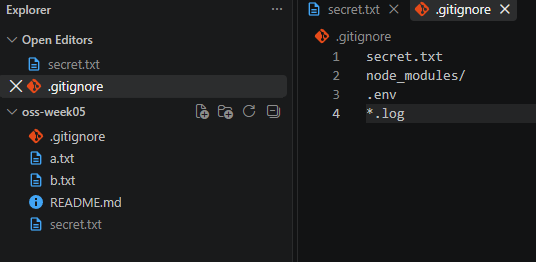

# P2. .gitignore — `.gitignore`, `secret.txt` — `oops: add secret` · `p2: gitignore`

프로그램은 API 키, 비밀번호, 토큰 같은 값을 파일에서 읽는 경우가 많습니다. 3주차에 카카오 API 키를 `.env` 파일에 넣은 것이 그 예입니다. 이런 파일은 **저장소에 올라가면 안 됩니다.** Public 이면 누구나 키를 보고, Private 이라도 팀원 전체에게 퍼집니다. 그래서 `.gitignore` 에 적어 Git 이 아예 건드리지 않게 합니다.

문제는 순서입니다. `.gitignore` 에 적기 **전에** 이미 add 와 커밋을 해 버렸다면, 나중에 `.gitignore` 에 넣어도 Git 은 그 파일을 계속 추적합니다.

이 문제에서 하는 것:
- 키 파일을 일부러 커밋한 뒤 `.gitignore` 에 넣어 보기 — 안 빠진다
- `git rm --cached` 로 추적에서 빼기
- `.gitignore` 패턴 세 가지 (폴더 / 파일 / 와일드카드)

1. 키가 든 파일을 흉내 냅니다. 새 파일 `secret.txt` 를 만들고 `KEY=abc123` 한 줄을 적어 저장합니다. 그리고 **일부러** 커밋합니다. `.gitignore` 에 넣는 것을 깜빡하고 키 파일을 커밋한 상황입니다.
   ```
   git add secret.txt
   git commit -m "oops: add secret"
   ```
2. 이제 이 파일을 Git 이 무시하게 만들어 봅니다. 무시할 파일 목록은 `.gitignore` 라는 이름의 파일에 한 줄에 하나씩 적습니다. 이 파일을 만들고 첫 줄에 `secret.txt` 를 적으면 됩니다. 두 가지 방법 중 하나로 하면 됩니다.
   - **VS Code**: 새 파일을 만들고 이름을 `.gitignore` 로(점으로 시작, 확장자 없음) 저장한 뒤, 내용으로 `secret.txt` 한 줄을 적고 저장합니다.
   - **터미널**: 아래 한 줄이 같은 일을 합니다. `echo '...'` 는 따옴표 안의 글자를 출력하는 명령이고, `>` 는 그 출력을 화면 대신 오른쪽 파일에 쓰라는 뜻입니다. 파일이 없으면 만들고, 있으면 **내용을 통째로 덮어씁니다.**
     ```
     echo 'secret.txt' > .gitignore
     ```
   어느 쪽이든 끝나면 `cat .gitignore` 를 쳐서 `secret.txt` 한 줄이 나오는지 확인합니다.
3. `git status --short` 를 칩니다. `?? .gitignore` 는 보이는데 **`secret.txt` 는 아무 표시도 없습니다.** 무시된 게 아니라, 이미 커밋된 파일이라 Git 이 계속 추적하고 있다는 뜻입니다. **`.gitignore` 는 "앞으로 add 할 때 빼라" 는 목록이지, 이미 들어간 파일을 빼 주지는 않습니다.**
4. 추적을 끊으려면 인덱스에서만 지웁니다. `--cached` 가 "디스크의 파일은 두고 Git 의 목록에서만 빼라" 는 뜻입니다.
   ```
   git rm --cached secret.txt
   ```
5. `git status --short` 와 `ls` 를 칩니다. status 에는 `D  secret.txt` 가 보이고, `ls` 에는 `secret.txt` 가 그대로 있어야 합니다.
   지금 상황은 이렇습니다. `D` 가 왼쪽에 있으니 인덱스(다음 커밋에 들어갈 목록)에서 이 파일이 빠졌다는 뜻입니다. 즉 **다음 커밋부터는 이 파일이 없는 것으로 기록됩니다.** 하지만 디스크의 파일은 그대로라 `ls` 에 보이고, 프로그램도 이 파일을 계속 읽을 수 있습니다. 키 파일은 로컬에서 쓰되 저장소에는 안 올리는 것이 목적이니, 이것이 원하는 상태입니다.
   아직 커밋은 안 했으니 히스토리는 안 바뀌었습니다. `oops` 커밋에는 여전히 이 파일이 들어 있습니다.
6. `.gitignore` 에 아래 세 줄을 **추가**합니다. VS Code 로 열어 `secret.txt` 아래에 다음의 세 줄을 추가로 적고 저장합니다. (터미널로 하려면 `>` 가 아니라 `>>` 를 써야 합니다. `>` 는 덮어쓰기, `>>` 는 끝에 이어 쓰기입니다.)
    ```
    node_modules/
    .env
    *.log
    ```
    한 줄이 한 패턴이고, 쓰는 방식이 세 가지 다릅니다.
    - `node_modules/` — 끝에 `/` 가 붙으면 **폴더**입니다. 그 폴더와 안의 모든 파일을 무시합니다. npm 이 패키지를 설치하는 폴더인데, 수천 개 파일이 생기고 `package.json` 만 있으면 언제든 다시 만들 수 있어서 저장소에 넣지 않습니다.
    - `.env` — 그냥 이름이면 **그 이름의 파일**(또는 폴더) 하나입니다. 1번의 `secret.txt` 와 같은 방식이고, 키를 넣어 두는 파일의 관례적 이름이 `.env` 입니다.
    - `*.log` — `*` 는 **아무 글자나 몇 개든** 이라는 와일드카드입니다. `error.log`, `npm-debug.log` 처럼 `.log` 로 끝나는 파일은 전부 무시합니다. 프로그램이 실행 중에 남기는 기록 파일이라 저장소에 올릴 이유가 없습니다.
    이 세 줄은 뒤 문제에서 실제로 씁니다.
7. `.gitignore` 와 `secret.txt` 의 추적 해제를 커밋합니다.
    ```
    git add .
    git commit -m "p2: gitignore"
    ```
8. **확인**: `git status --short` 를 쳤을 때 아무것도 안 나와야 합니다. 특히 `secret.txt` 가 **아예 안 보여야** 합니다. `ls` 에는 여전히 있습니다.
   VS Code 탐색기에서 `secret.txt` 가 **회색으로 흐리게** 보이면 무시되고 있다는 표시입니다. 진하게 보이면 `.gitignore` 의 철자를 확인합니다.

   

   3번에서는 이 파일이 "추적 중" 이라 status 에 표시가 없었고, 지금은 "무시됨" 이라 표시가 없습니다. 겉으로는 같아 보이지만 반대 상황입니다. 구분하려면 `git ls-files` 를 쳐 봅니다. Git 이 추적하는 파일 목록이 나오는데, 3번 시점이었다면 `secret.txt` 가 있었을 것이고 지금은 없습니다.
   정리하면: 이 파일은 디스크에 있고, `.gitignore` 에 올라 있고, 마지막 커밋(`p2: gitignore`)부터는 저장소에 없습니다. 앞으로 `git add .` 을 아무리 쳐도 이 파일은 들어가지 않습니다. 다만 `oops` 커밋에는 남아 있어서, 히스토리를 뒤지면 키가 보입니다.

> **실전이라면 어떻게 되나.** 커밋은 그 시점의 파일 전체를 찍은 사진과 같고, Git 은 모든 커밋을 `.git` 폴더에 보관합니다. 지금 파일을 뺐어도 `oops` 커밋이라는 사진 안에는 `KEY=abc123` 이 그대로 있습니다. `git log` 에서 그 커밋을 골라 `git show oops커밋해시:secret.txt` 를 치면 누구나 키를 읽을 수 있습니다. 방금 한 커밋이라면 `reset` 으로 그 커밋을 풀고 다시 만들면 됩니다(뒤쪽 실습에 나옵니다). 여러 커밋 전에 있다면 그 뒤 커밋을 전부 다시 써야 해서 별도 도구가 필요하고, 이 수업 범위 밖입니다.
>
> 아직 push 하지 않았다면 이 사진은 **내 컴퓨터에만** 있습니다. 히스토리를 고치든 저장소를 새로 만들든, 아무도 못 본 상태에서 정리할 수 있습니다.
> **push 했다면** 그 사진이 GitHub 서버에 복사된 것입니다. 내가 나중에 히스토리를 지우고 다시 push 해도, 그 사이에 누군가 clone 했거나 GitHub 이 캐시해 둔 사본은 없어지지 않습니다. 실제로 GitHub 에 올라온 키는 봇이 몇 분 안에 긁어 갑니다. 그래서 push 한 뒤에는 히스토리를 고치는 게 아니라 **키 자체를 폐기하고 새로 발급**해야 합니다.
>
> 결국 가장 싼 방법은 처음부터 안 들어가게 하는 것입니다. 키 파일 이름을 `.env` 로 정해 두고, 저장소를 만들 때 `.gitignore` 에 `.env` 부터 적는 이유가 이것입니다.

---

[← 문제 목록](../README.md#문제) · [이전: P1](P1_status.md) · [다음: P3](P3_undo.md) · [부록: 흔한 오류](../README.md#부록-흔한-오류)
