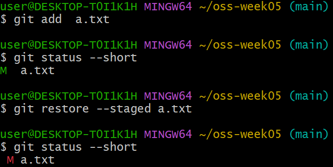

# P3. 되돌리기 ① restore 와 amend — `notes.txt` — `p3: undo`

커밋하기 전에 되돌리는 방법 두 가지와, 방금 한 커밋을 고치는 방법 하나입니다. 셋 다 히스토리를 바꾸지 않거나(restore) 마지막 커밋 하나만 바꾸므로(amend), 아직 push 하지 않은 지금 안전하게 연습할 수 있습니다.

이론 강의의 세 트리로 보면 이렇습니다. Git 은 파일을 세 벌 갖고 있습니다.
- **Working Directory** — 내가 편집기로 보는 실제 파일
- **Index** — add 한 것. 다음 커밋에 들어갈 내용
- **HEAD** — 마지막 커밋의 내용

편집하면 Working Directory 만 바뀌고, add 하면 Index 가 따라오고, commit 하면 HEAD 가 따라옵니다. 되돌리기는 이 셋 중 하나를 다른 하나로 덮어쓰는 것입니다.

이 문제에서 하는 것:
- `git restore <file>` — Working Directory 를 Index 로 덮어쓴다 (add 안 한 편집을 버린다)
- `git restore --staged <file>` — Index 를 HEAD 로 덮어쓴다 (add 를 취소한다. Working Directory 는 그대로)
- `git commit --amend` — HEAD 를 Index 로 다시 만든다 (마지막 커밋을 지금 Index 내용으로 갈아 끼운다)

## ① 작업 파일 되돌리기 (`git restore <file>`)

Working Directory 만 바뀐 상태를 만들고, 그것을 Index 로 되돌립니다. Index 와 HEAD 는 아직 같으니 결과적으로 마지막 커밋 상태로 돌아갑니다.

1. VS Code 에서 `README.md` 를 열어 첫 줄 `# oss-week05` 를 지우고, 그 자리에 `broken` 이라고 적고 저장합니다. 일부러 망가뜨린 상황입니다.
2. 터미널에서 `git status --short` 를 칩니다. ` M README.md` 가 보입니다.
3. Working Directory 를 Index 의 내용으로 되돌립니다.
   ```
   git restore README.md
   ```
4. `git status --short` 를 다시 칩니다. `README.md` 줄이 사라졌으면 됩니다. VS Code 에서 파일을 보면 원래 내용으로 돌아와 있습니다. 주의할 점 하나. **restore 로 버린 편집(`broken`)은 되살릴 수 없습니다.** 커밋도 add 도 안 한 내용이라 Git 이 어디에도 보관하지 않았기 때문입니다. 되돌리기 전에 정말 버려도 되는지 확인하는 습관이 필요합니다.

## ② add 취소 (`git restore --staged <file>`)

Working Directory 와 Index 가 같이 바뀐 상태(add 까지 한 상태)를 만들고, Index 만 HEAD 로 되돌립니다. Working Directory 는 건드리지 않아서 수정한 내용은 남습니다.

5. VS Code 에서 `a.txt` 를 열어 맨 아래에 `staged line` 한 줄을 추가하고 저장한 뒤, 터미널에서 add 합니다.
   ```
   git add a.txt
   ```
6. `git status --short` 를 칩니다. `M  a.txt` — **M 이 왼쪽**에 있습니다. add 된 상태(staged)라는 뜻입니다.
7. Index 를 HEAD 의 내용으로 되돌립니다. Working Directory 의 파일은 그대로입니다.
   ```
   git restore --staged a.txt
   ```
8. `git status --short` 를 칩니다. ` M a.txt` — **M 이 오른쪽**으로 갔습니다. 수정은 남아 있고 add 만 풀렸다는 뜻입니다.

   5~8번을 이어서 치면 이렇게 보입니다. 같은 `M` 인데 자리가 왼쪽에서 오른쪽으로 옮겨 간 것만 다릅니다.

   

9. 정리: `git restore a.txt` 로 수정도 되돌립니다. `git status --short` 에 `a.txt` 가 안 보이면 됩니다.

## ③ 마지막 커밋 고치기 (`git commit --amend`)

이번에는 HEAD 까지 바뀐 상태(커밋한 상태)입니다. amend 는 그 커밋을 버리고 지금 Index 내용으로 새 커밋을 만들어 HEAD 를 거기로 옮깁니다.

10. 새 파일 `notes.txt` 를 만들고 `first` 한 줄을 적어 저장한 뒤 add 합니다.
    ```
    git add notes.txt
    ```
11. **일부러 틀린 메시지**로 커밋합니다. 콜론이 빠져 있습니다.
    ```
    git commit -m "p3 undo"
    ```
12. 메시지를 고칩니다. `--amend` 는 마지막 커밋을 지우고 같은 내용으로 새 커밋을 만드는 것입니다.
    ```
    git commit --amend -m "p3: undo"
    ```
13. 11번과 12번의 출력을 보면 첫 줄이 `[main 1a2b3c4] p3 undo` 처럼 나오는데, **대괄호 안의 해시가 서로 다릅니다.** 커밋을 고친 게 아니라 새 커밋을 만들고 옛것을 버린 것이라, 내용이 같아도 다른 커밋입니다.
14. 커밋에 파일 하나를 빠뜨린 상황도 해 봅니다. `notes.txt` 에 `second` 줄을 추가하고 저장한 뒤, 새 커밋을 만들지 않고 마지막 커밋에 끼워 넣습니다. `--no-edit` 은 "메시지는 그대로" 입니다.
    ```
    git add notes.txt
    git commit --amend --no-edit
    ```
15. **확인**: `git status --short` 가 비어 있고, `git log --oneline -1` 을 쳤을 때 메시지가 `p3: undo` (콜론 있음)여야 합니다. `git log --oneline` 전체를 보면 `p3 undo` 는 어디에도 없고, `git show --stat HEAD` 를 치면 마지막 커밋에 `notes.txt` 가 두 줄짜리로 들어 있습니다.

---

[← 문제 목록](../README.md#문제) · [이전: P2](P2_gitignore.md) · [다음: P4](P4_branch.md) · [부록: 흔한 오류](../README.md#부록-흔한-오류)
