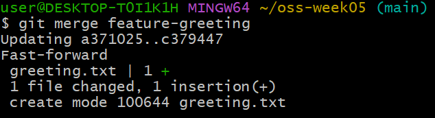
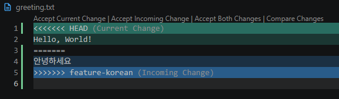
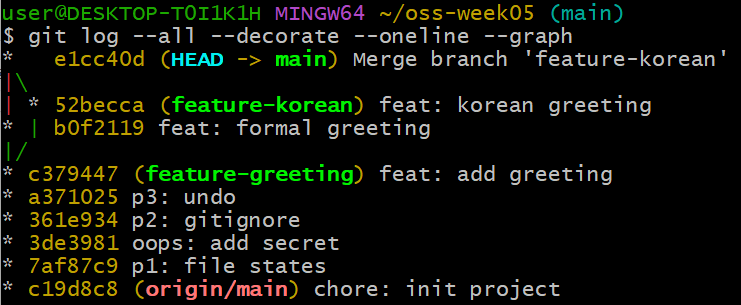
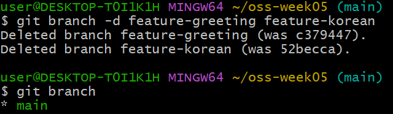

# P4. 브랜치·머지·충돌 — `greeting.txt` — 머지 커밋 `Merge branch 'feature-korean'`

브랜치(branch)는 main 을 건드리지 않고 작업을 이어 가는 갈래, 머지(merge)는 그 갈래를 다시 합치는 것입니다.

이 문제에서 하는 것:
- 충돌 없는 머지(fast-forward) 한 번
- 같은 줄을 다르게 고쳐 **충돌(conflict)** 이 나는 머지 한 번 — 충돌 메시지를 읽고 손으로 풉니다

팀 프로젝트에서 매주 만날 상황입니다.

## ① fast-forward 머지 (`git checkout -b`, `git merge`)

1. 새 브랜치를 만들면서 그 브랜치로 옮겨 갑니다. `-b` 가 "만들면서 이동" 입니다.
   ```
   git checkout -b feature-greeting
   ```
   터미널 프롬프트 끝의 괄호가 `(main)` 에서 `(feature-greeting)` 으로 바뀝니다. 지금 어느 브랜치에 있는지는 이 괄호로 항상 확인할 수 있습니다.
2. 새 파일 `greeting.txt` 를 만들고 `hello` 한 줄을 적어 저장한 뒤 커밋합니다. 이 커밋은 `feature-greeting` 브랜치에만 쌓입니다.
   ```
   git add .
   git commit -m "feat: add greeting"
   ```
3. main 으로 돌아갑니다.
   ```
   git checkout main
   ```
4. `ls` 를 칩니다. **`greeting.txt` 가 없습니다.** 지워진 게 아니라 다른 브랜치에 있는 것입니다. VS Code 탐색기에서도 사라져 보입니다.
5. `feature-greeting` 을 main 에 합칩니다. 합칠 때는 **받는 쪽(main)에 서서** 가져올 쪽을 지정합니다.
   ```
   git merge feature-greeting
   ```
   출력 두 번째 줄에 `Fast-forward` 가 있어야 합니다. main 이 그동안 움직이지 않았으니 Git 이 main 포인터를 그냥 앞으로 밀어 준 것입니다. 새 커밋은 생기지 않습니다. `ls` 에 `greeting.txt` 가 다시 보입니다.

   


## ② 3-way 머지와 충돌 (`git merge` → 충돌 해결 → `git add`, `git commit`)

6. 두 번째 브랜치를 만들어 이동합니다.
   ```
   git checkout -b feature-korean
   ```
7. `greeting.txt` 를 열어 `hello` 를 `안녕하세요` 로 **바꾸고**(줄을 추가하는 게 아니라 그 줄을 고칩니다) 저장한 뒤 커밋합니다.
   ```
   git commit -am "feat: korean greeting"
   ```
   `-a` 는 "이미 추적 중인 파일의 수정을 add 까지 한 번에" 입니다. 새 파일에는 안 통합니다.
8. main 으로 돌아갑니다.
   ```
   git checkout main
   ```
   VS Code 에서 `greeting.txt` 를 보면 다시 `hello` 입니다(feature-korean 의 수정은 그 브랜치에만 있습니다).
9. **같은 줄을 다른 내용으로** 고칩니다. `hello` 를 `Hello, World!` 로 바꾸고 저장한 뒤 커밋합니다.
   ```
   git commit -am "feat: formal greeting"
   ```
   이제 main 과 feature-korean 이 같은 부모에서 갈라져 각자 한 칸씩 나아간 상태입니다.
10. 합쳐 봅니다.
   ```
   git merge feature-korean
   ```
   이번에는 실패합니다. 같은 줄을 서로 다르게 고쳤기 때문입니다.
   ```
   CONFLICT (content): Merge conflict in greeting.txt
   Automatic merge failed; fix conflicts and then commit the result.
   ```
11. `git status` 를 칩니다. `Unmerged paths` 아래에 `both modified: greeting.txt` 가 있습니다. 충돌이 난 파일 목록입니다.
12. VS Code 에서 `greeting.txt` 를 엽니다. Git 이 마커를 끼워 넣어 두었습니다.
    ```
    <<<<<<< HEAD
    Hello, World!
    =======
    안녕하세요
    >>>>>>> feature-korean
    ```
    - `<<<<<<<` ~ `=======` : 내가 서 있는 쪽(main)의 내용. VS Code 는 **Current Change** 라고 부릅니다.
    - `=======` ~ `>>>>>>>` : 가져온 쪽(feature-korean)의 내용. **Incoming Change**.

    
13. 마커 세 줄을 지우고 **두 문장을 다 남겨** 아래 두 줄짜리 파일로 만든 뒤 저장합니다. (VS Code 가 파일 위에 띄우는 **Accept Both Changes** 를 눌러도 같은 결과입니다.)
    ```
    Hello, World!
    안녕하세요
    ```
14. 충돌을 풀었다고 Git 에 알립니다.
    ```
    git add greeting.txt
    ```
15. 머지 커밋을 만듭니다. 이번에는 `-m` 없이 칩니다.
    ```
    git commit
    ```
    Git 이 메시지를 미리 채워 둔 편집기가 열립니다. 그대로 저장하고 닫으면 됩니다.
    - VS Code 가 열리면: `Ctrl+S` 로 저장하고 탭을 닫습니다.
    - 검은 화면의 Vim 이 열리면: `:wq` 를 치고 Enter.
16. 히스토리를 그래프로 봅니다.
    ```
    git log --all --decorate --oneline --graph
    ```
    갈라졌다가 `Merge branch 'feature-korean'` 에서 합쳐진 모양이 문자로 그려집니다. 맨 위가 최신입니다. `feat: add greeting` 에서 두 갈래(`feat: korean greeting`, `feat: formal greeting`)로 나뉘고 머지 커밋에서 다시 하나가 됩니다. 괄호 안은 그 커밋을 가리키는 브랜치 이름입니다. `origin/main` 이 맨 아래 첫 커밋에 있는 것은 P0 이후로 push 를 안 했기 때문입니다.

    

    > **참고 — 매번 치기 길다면.** 네 옵션의 머리글자를 딴 `adog` 라는 별명(alias)을 등록해 두면 `git adog` 로 같은 결과가 나옵니다. 한 번만 하면 됩니다.
    > ```
    > git config --global alias.adog "log --all --decorate --oneline --graph"
    > ```
    > 이후로는 `git adog`, `git adog -5` 처럼 씁니다. 이 수업의 뒤 문제들은 전부 풀어서 쓰지만, 등록해 두었으면 `adog` 로 쳐도 됩니다. `adog` 는 정해진 이름이 아니라 네 옵션의 머리글자일 뿐입니다. 현업에서는 `lg` 같은 짧은 이름에 색·날짜·작성자까지 꾸민 긴 alias 를 두는 사람이 많은데, 그건 각자 취향입니다.
17. 다 합쳐진 브랜치는 지웁니다. 이름표만 없어지고 커밋은 main 에 남습니다.
    ```
    git branch -d feature-greeting feature-korean
    ```
    `Deleted branch … (was 해시)` 두 줄이 나옵니다. 괄호 안 해시는 그 브랜치가 가리키던 커밋인데, 커밋 자체는 main 히스토리에 그대로 있습니다. `git branch` 를 쳤을 때 `* main` 한 줄만 나오면 됩니다.

    
18. **확인**: `cat greeting.txt` 가 두 줄이고 `<<<<<<<` 같은 마커가 없어야 합니다. `git log --oneline --graph` 에 `Merge branch 'feature-korean'` 커밋이 보여야 합니다.

---

[← 문제 목록](../README.md#문제) · [이전: P3](P3_undo.md) · [다음: P5](P5_reset.md) · [부록: 흔한 오류](../README.md#부록-흔한-오류)
