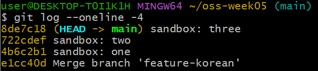
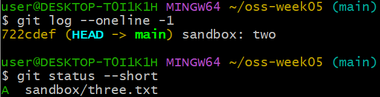
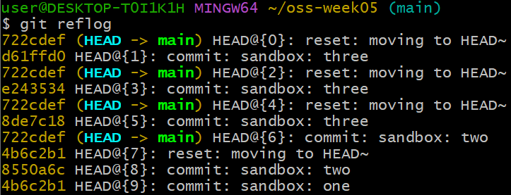

# P5. 되돌리기 ② reset 과 reflog — `sandbox/` — `sandbox: one` · `two` · `three`

P3 의 restore 는 파일을 되돌렸고, reset 은 **커밋을 되돌립니다.** HEAD 를 이전 커밋으로 옮기는데, Index 와 Working Directory 를 어디까지 같이 되돌리느냐에 따라 세 가지입니다.
- `--soft` — HEAD 만
- `--mixed` (기본) — HEAD 와 Index
- `--hard` — HEAD, Index, Working Directory 전부

이 문제에서 하는 것:
- 같은 커밋을 세 번 만들고 세 번 다르게 되돌려서 세 옵션의 차이를 `status` 한 줄로 확인
- `--hard` 로 날린 커밋을 `reflog` 로 되살리기

이 저장소는 아직 push 하지 않았으니 reset 을 마음껏 써도 됩니다. push 한 뒤에는 P6 의 revert 를 씁니다.

## 커밋 세 개 만들기 (`git add`, `git commit`)

1. VS Code 탐색기에서 새 폴더 아이콘으로 `sandbox` 폴더를 만듭니다(터미널이면 `mkdir sandbox`). 그 폴더 안에 새 파일 `one.txt` 를 만들고 `one` 한 줄을 적어 저장한 뒤 커밋합니다.
   ```
   git add sandbox
   git commit -m "sandbox: one"
   ```
2. 같은 폴더에 새 파일 `two.txt` 를 만들고 `two` 한 줄을 적어 저장한 뒤 커밋합니다. 새 파일이라 add 부터 해야 합니다.
   ```
   git add sandbox
   git commit -m "sandbox: two"
   ```
3. 한 번 더. 새 파일 `three.txt` 에 `three` 한 줄을 적어 저장한 뒤 커밋합니다.
   ```
   git add sandbox
   git commit -m "sandbox: three"
   ```
4. `git log --oneline -4` 를 칩니다. 위에서부터 `sandbox: three`, `two`, `one`, 그 아래 `Merge branch 'feature-korean'` 이 보여야 합니다. `HEAD -> main` 이 맨 위 `sandbox: three` 에 붙어 있습니다. 지금 여기 서 있다는 뜻이고, reset 은 이 HEAD 를 아래로 옮기는 것입니다.

   


## soft (`git reset --soft HEAD~`)

5. HEAD 만 한 칸 뒤로 옮깁니다. `HEAD~` 는 "지금 커밋의 부모" 입니다.
   ```
   git reset --soft HEAD~
   ```
6. `git log --oneline -1` 과 `git status --short` 를 칩니다. 로그의 맨 위가 `sandbox: two` 로 바뀌었고(three 커밋이 사라짐), status 에는 `A  sandbox/three.txt` 가 보입니다. **커밋만 풀렸고 파일은 add 된 채 그대로** 라는 뜻입니다.

   

7. 그대로 다시 커밋합니다. add 는 이미 되어 있습니다.
   ```
   git commit -m "sandbox: three"
   ```

## mixed, 기본 (`git reset HEAD~`)

8. 옵션 없이 reset 합니다. `--mixed` 가 기본이라 안 써도 됩니다.
   ```
   git reset HEAD~
   ```
9. 같은 두 명령을 칩니다. 이번에는 status 가 `?? sandbox/three.txt` 입니다. **커밋도 풀리고 add 도 풀렸지만 파일은 폴더에 남아 있다** 는 뜻입니다.
10. 다시 커밋합니다. 이번에는 add 부터 해야 합니다.
   ```
   git add .
   git commit -m "sandbox: three"
   ```

## hard (`git reset --hard HEAD~`)

11. 세 트리를 전부 되돌립니다.
    ```
    git reset --hard HEAD~
    ```
12. 같은 두 명령에 `ls sandbox/` 까지 칩니다. status 는 비어 있고, `ls` 에 `one.txt two.txt` 만 나옵니다. **`three.txt` 가 폴더에서도 사라졌습니다.** 커밋하지 않은 수정이었다면 이 순간 영영 잃는 것입니다.

세 번의 status 를 나란히 보면 이렇습니다.
```
$ git reset --soft HEAD~   →  A  sandbox/three.txt     (add 된 채)
$ git reset HEAD~          →  ?? sandbox/three.txt     (add 풀림, 파일은 있음)
$ git reset --hard HEAD~   →  (비어 있음)  ls: one.txt two.txt   (파일도 없음)
```

## reflog 로 복구 (`git reflog`, `git reset --hard HEAD@{1}`)

13. 커밋은 사라진 게 아니라 아무도 가리키지 않게 되었을 뿐입니다. 그런데 `git log` 에는 안 나옵니다. `log` 는 **지금 HEAD 에서 부모를 따라 거슬러 올라가며** 커밋을 보여 주는데, 버린 커밋은 그 줄기 위에 없기 때문입니다.
    `reflog` 는 다릅니다. **HEAD 가 지금까지 어디에 있었는지를 시간 순으로** 전부 기록한 것입니다. 커밋을 하든 reset 을 하든 checkout 을 하든, HEAD 가 움직인 순간마다 한 줄씩 남습니다. 그래서 log 에서 사라진 커밋도 reflog 에는 "그때 HEAD 가 거기 있었다" 는 기록으로 남아 있습니다.
    이 기록은 내 컴퓨터에만 있고 push 되지 않습니다.
    ```
    git reflog
    ```
    한 줄이 HEAD 가 한 번 움직인 기록이고, 맨 위가 가장 최근입니다. `HEAD@{0}` 이 방금의 `reset: moving to HEAD~`, 그 아래 `HEAD@{1}` 이 `commit: sandbox: three` 입니다. 세 번 커밋하고 세 번 reset 한 것이 위에서부터 번갈아 보입니다. `HEAD@{1}`, `{3}`, `{5}` 의 해시가 서로 다른 것은 `sandbox: three` 를 세 번 새로 만들었기 때문입니다.

    
14. 그 자리로 돌아갑니다.
    ```
    git reset --hard HEAD@{1}
    ```
15. `ls sandbox/` 에 세 파일이 다 돌아왔고, `git log --oneline -1` 이 `sandbox: three` 이면 복구된 것입니다.
16. 정리하면, 세 reset 은 모두 HEAD 를 한 칸 뒤로 옮기고, 거기에 더해 `--soft` 는 아무것도, `--mixed` 는 인덱스까지, `--hard` 는 작업 폴더까지 되돌립니다.
17. **확인**: `ls sandbox/` 에 `one.txt two.txt three.txt`, `git log --oneline -5` 에 `sandbox: three` 가 있고, `git status --short` 는 비어 있어야 합니다.

---

[← 문제 목록](../README.md#문제) · [이전: P4](P4_branch.md) · [다음: P6](P6_revert.md) · [부록: 흔한 오류](../README.md#부록-흔한-오류)
