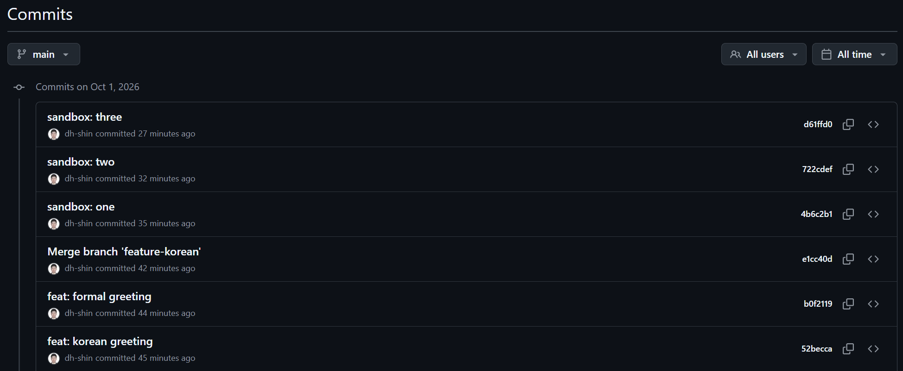
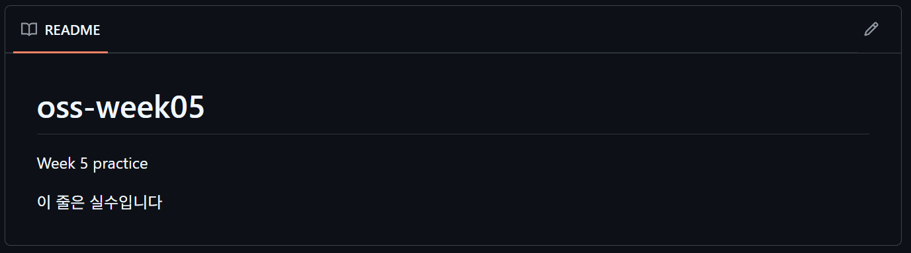
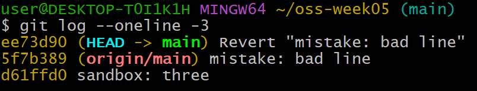
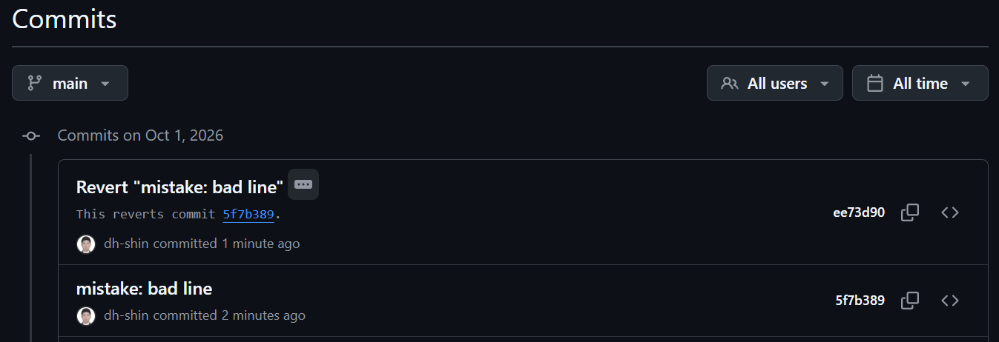

# P6. 되돌리기 ③ revert — `README.md` — `mistake: bad line` · `Revert "mistake: bad line"`

P5 의 reset 은 커밋을 히스토리에서 지웁니다. 내 컴퓨터에만 있는 커밋이라면 괜찮지만, **이미 push 한 커밋을 reset 으로 지우면 원격과 내 히스토리가 어긋나서** 다음 push 가 거부되고, 억지로 밀어 넣으면 팀원들의 저장소가 꼬입니다.

그래서 push 한 커밋은 revert 로 되돌립니다. revert 는 **그 커밋의 변경을 정확히 반대로 적용하는 새 커밋을 하나 더 만드는 것**입니다. 실수한 커밋도 남고, 되돌린 커밋도 남습니다.

이 문제에서 하는 것:
- 처음으로 push
- 일부러 실수 커밋을 만들어 push
- `git revert` 로 되돌리고 다시 push

1. 여기서 처음으로 push 합니다. 지금까지 push 를 미룬 이유는 앞 문제들에서 커밋을 고치고(amend) 지우는(reset) 연습을 했기 때문입니다. 이미 push 한 커밋을 고치면 원격과 어긋나서 다음 push 가 거부됩니다. 그 연습이 끝났으니 이제 올려도 됩니다.
   ```
   git push
   ```
   브라우저에서 저장소 페이지를 새로 고쳐(`F5`) 파일 목록 위의 시계 아이콘 옆 **N Commits** 링크를 누르면 지금까지의 커밋이 전부 보입니다. 맨 위가 최신이고, `git log --oneline` 에서 본 것과 같은 순서입니다. 머지 커밋도 한 줄로 들어가 있습니다.

   
2. `README.md` 끝에 `이 줄은 실수입니다` 한 줄을 추가하고 저장한 뒤 커밋하고 push 합니다.
   ```
   git commit -am "mistake: bad line"
   git push
   ```
   이제 이 실수는 GitHub 에 올라갔습니다. 브라우저에서 새로 고치면 README 아래에 그 줄이 보입니다.

   
3. 되돌립니다. `HEAD` 는 "마지막 커밋" 입니다.
   ```
   git revert HEAD
   ```
   Git 이 `Revert "mistake: bad line"` 이라는 메시지를 미리 채워 둔 편집기가 열립니다. 메시지는 그대로 두고 저장하고 닫으면 됩니다.
   - VS Code 가 열리면: `Ctrl+S` 로 저장하고 탭을 닫습니다.
   - 검은 화면의 Vim 이 열리면: `:wq` 를 치고 Enter.
4. `git log --oneline -3` 을 칩니다. 맨 위에 `Revert "mistake: bad line"` 이 **새로 추가**됐고, 그 아래 `mistake: bad line` 도 **그대로 있습니다.** `origin/main` 이 `mistake` 커밋에 붙어 있는 것은 revert 커밋을 아직 push 하지 않았기 때문입니다.

   

5. `cat README.md` 로 실수 줄이 사라졌는지 봅니다. 파일 내용은 실수 전으로 돌아갔지만, 히스토리에는 실수와 수정이 둘 다 남아 있습니다.
6. push 합니다. revert 커밋은 평범한 커밋이라 그냥 올라갑니다.
   ```
   git push
   ```
   브라우저에서 커밋 목록을 새로 고치면 `mistake: bad line` 과 `Revert "mistake: bad line"` 이 둘 다 보입니다. Revert 커밋 아래에 `This reverts commit 5f7b389.` 처럼 어느 커밋을 되돌린 것인지가 적혀 있고, 그 해시를 누르면 원래 커밋으로 갑니다.

   
7. **확인**: 브라우저에서 README 에 실수 줄이 없고, 커밋 목록 맨 위에 `Revert "mistake: bad line"`, 그 아래 `mistake: bad line` 이 보여야 합니다. `git status --short` 는 비어 있습니다.

---

[← 문제 목록](../README.md#문제) · [이전: P5](P5_reset.md) · [다음: P7](P7_remote.md) · [부록: 흔한 오류](../README.md#부록-흔한-오류)
