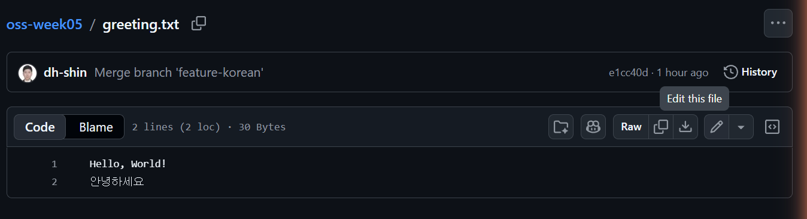
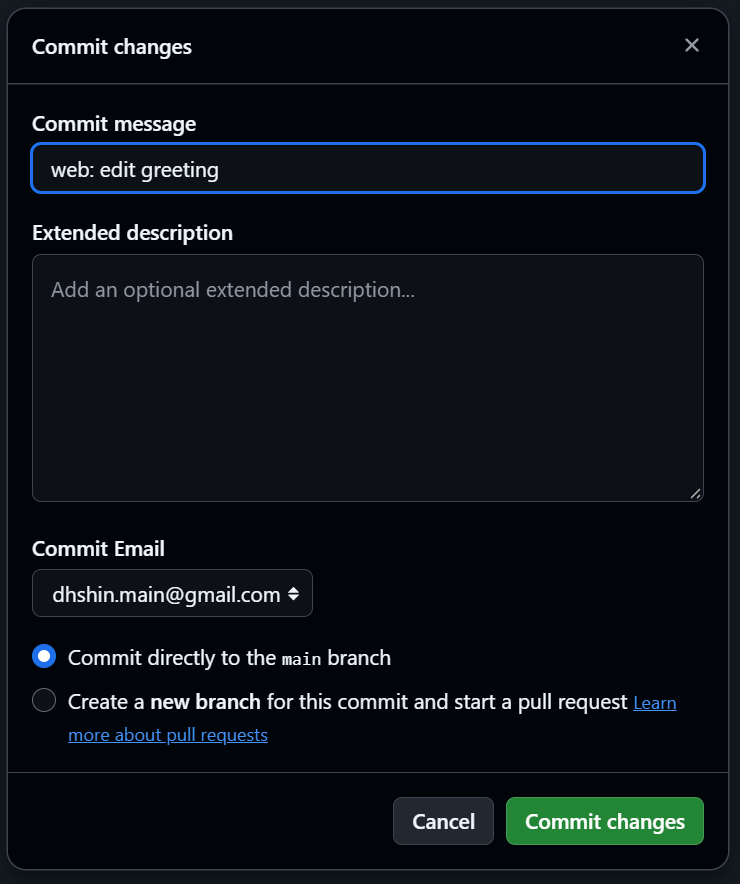
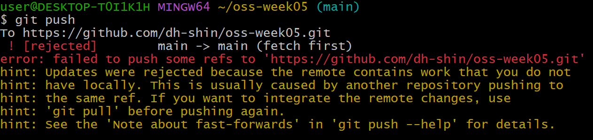
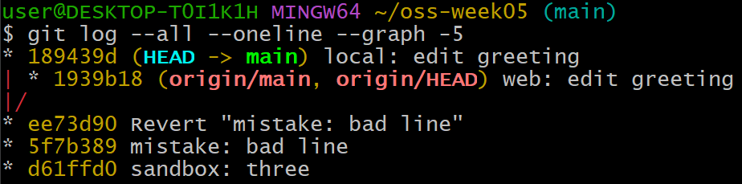
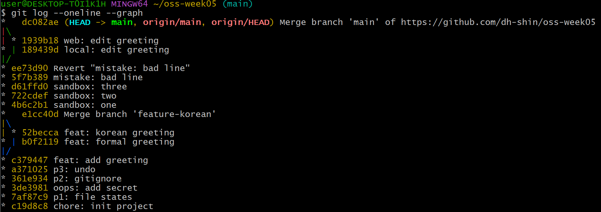

# P7. 원격 충돌 — `greeting.txt` — `web: edit greeting` · `local: edit greeting` · 머지 커밋

팀 작업에서는 내가 push 하려는 사이에 팀원이 먼저 push 해 둔 일이 늘 생깁니다. 그러면 내 push 는 거부되고, 먼저 pull 해서 합친 뒤 다시 push 해야 합니다. 합칠 때 같은 줄을 고쳤으면 P4 와 똑같은 충돌이 납니다.

혼자서도 이 상황을 만들 수 있습니다. **GitHub 웹 화면에서 파일을 고쳐 커밋하면 그 커밋은 GitHub 에만 있고 내 컴퓨터에는 없습니다.** 팀원이 push 한 것과 같은 상태입니다.

이 문제에서 하는 것:
- 웹 편집기로 커밋 (팀원 역할)
- 로컬에서 같은 줄을 고쳐 커밋 → push 거부
- `fetch` 로 상황 보기 → `pull` → 충돌 해결 → push

## 팀원 역할: 웹에서 커밋 (GitHub 웹 편집기)

1. 브라우저에서 `<ID>/oss-week05` 저장소 페이지를 열고 파일 목록에서 `greeting.txt` 를 누릅니다.
2. 파일 내용 오른쪽 위, **Raw** 버튼 옆의 연필 아이콘(마우스를 올리면 **Edit this file**)을 누르면 웹 편집기가 열립니다.

   

3. 첫 줄 `Hello, World!` 를 `Hello from the web` 으로 바꿉니다. 둘째 줄 `안녕하세요` 는 그대로 둡니다.
4. 오른쪽 위 초록색 **Commit changes...** 버튼을 누르면 아래 창이 뜹니다. **Commit message** 칸에 `web: edit greeting` 을 적고, 나머지는 그대로 둡니다. **Commit directly to the main branch** 가 선택되어 있어야 합니다(아래 "Create a new branch" 를 고르면 이 실습과 다른 길로 갑니다). 초록색 **Commit changes** 를 누릅니다.

   

5. 저장소 페이지로 돌아오면 커밋 수가 하나 늘어 있습니다. **이 커밋은 GitHub 에만 있습니다.** 내 컴퓨터의 저장소는 아직 모릅니다.

## 내 역할: 로컬에서 같은 줄 커밋 (`git commit -am`, `git push` → 거부)

6. 터미널로 돌아옵니다. **pull 은 하지 않습니다.** VS Code 에서 `greeting.txt` 첫 줄을 `Hello from my laptop` 으로 바꾸고 저장한 뒤 커밋합니다.
   ```
   git commit -am "local: edit greeting"
   ```
7. push 해 봅니다.
   ```
   git push
   ```
   `! [rejected]  main -> main (fetch first)` 와 함께 거부됩니다. 아래 hint 에 이유가 적혀 있습니다: 원격에 내가 갖고 있지 않은 커밋이 있다(`the remote contains work that you do not have locally`). 그리고 해결책도 적혀 있습니다: push 하기 전에 `git pull` 을 하라. 이 메시지는 팀 작업에서 자주 보게 되니 한 번 끝까지 읽어 둡니다.

   


## 상황 보기 (`git fetch`, `git log --all --graph`)

8. 원격의 상태를 받아옵니다. fetch 는 받아오기만 하고 내 브랜치에 합치지는 않아서 언제 쳐도 안전합니다.
   ```
   git fetch
   ```
9. 그래프로 봅니다.
   ```
   git log --all --oneline --graph -5
   ```
   `main`(내 커밋 `local: edit greeting`)과 `origin/main`(웹 커밋 `web: edit greeting`)이 `Revert` 커밋에서 갈라진 모양이 보입니다. P4 에서 두 브랜치가 갈라진 것과 같은 그림입니다. 원격도 결국 브랜치 하나이고, 합치는 방법도 같습니다. `origin/HEAD` 는 "원격의 기본 브랜치" 표시라 지금은 신경 쓰지 않아도 됩니다.

   


## 합치고 다시 push (`git pull` → 충돌 해결 → `git push`)

10. pull 로 합칩니다. pull 은 fetch 와 merge 를 한 번에 하는 것입니다.
    ```
    git pull
    ```
    `CONFLICT (content): Merge conflict in greeting.txt` 가 납니다. 같은 첫 줄을 웹과 로컬이 다르게 고쳤기 때문입니다.
11. VS Code 에서 `greeting.txt` 를 엽니다. P4 와 같은 마커가 있습니다. 위쪽(`HEAD`)이 내 로컬, 아래쪽이 웹입니다. 마커를 지우고 첫 줄을 원하는 한 줄로 정리합니다(둘 중 하나를 고르든 합치든 자유). 둘째 줄 `안녕하세요` 는 그대로 둡니다. 저장합니다.
12. 해결을 알리고 머지 커밋을 만듭니다.
    ```
    git add greeting.txt
    git commit
    ```
    메시지가 미리 채워진 편집기가 열립니다. 그대로 저장하고 닫습니다.
    - VS Code 가 열리면: `Ctrl+S` 로 저장하고 탭을 닫습니다.
    - 검은 화면의 Vim 이 열리면: `:wq` 를 치고 Enter.
13. 다시 push 합니다. 이번에는 됩니다.
    ```
    git push
    ```
14. **확인**: 브라우저에서 새로 고쳐 `greeting.txt` 첫 줄이 11번에서 정리한 내용이고, 커밋 목록에 `web: edit greeting`, `local: edit greeting`, `Merge branch 'main' of ...` 가 다 보여야 합니다. `git log --oneline --graph` 에서 머지 커밋이 둘(P4, P7)입니다.

    `git log --oneline --graph` 로 전체를 보면 오늘 한 일이 한 장에 들어 있습니다. 위에서부터 P7 의 머지(웹과 로컬이 갈라졌다 합쳐짐), P6 의 mistake 와 Revert, P5 의 sandbox 셋, P4 의 머지(두 feature 브랜치), 그리고 P3·P2·P1·P0 의 커밋 순서입니다. 맨 위 커밋에 `HEAD -> main` 과 `origin/main` 이 같이 붙어 있으면 로컬과 원격이 완전히 같은 상태라는 뜻입니다.

    

---

[← 문제 목록](../README.md#문제) · [이전: P6](P6_revert.md) · [다음: P8](P8_node.md) · [부록: 흔한 오류](../README.md#부록-흔한-오류)
