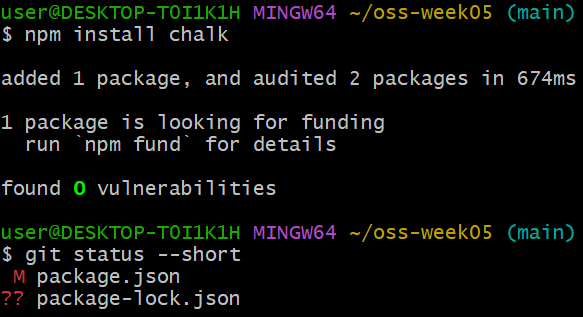
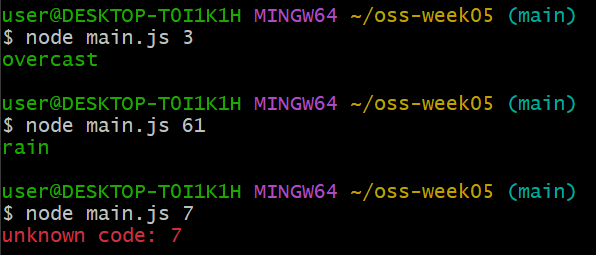
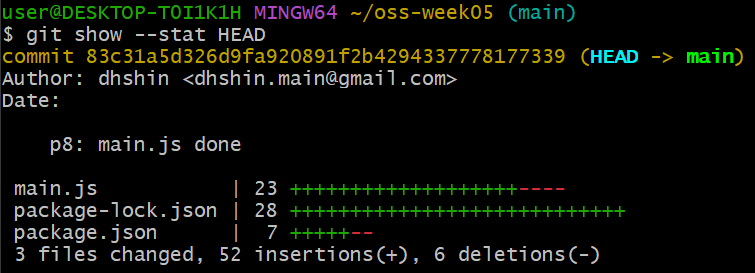
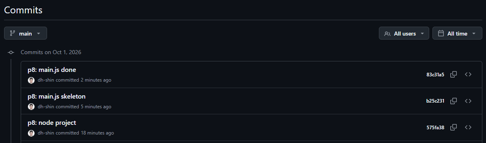

# P8. Node 프로젝트 처음부터 — `package.json`, `main.js` — `p8: node project` · `p8: main.js skeleton` · `p8: main.js done`

지금까지의 저장소는 텍스트 파일뿐이었습니다. 마지막으로 이 저장소를 Node 프로젝트로 만들고, 작은 프로그램 하나를 두 단계(골격 → 완성)로 커밋합니다.

이 문제에서 하는 것:
- ① `npm init` 으로 `package.json` 만들기 → ESM 설정 → 커밋
- ② 날씨 코드를 사람 말로 바꾸는 CLI `main.js` — 골격을 먼저 커밋하고, 패키지(`chalk`)를 설치해 채운 뒤 다시 커밋
- 그 과정에서 P2 에서 넣어 둔 `.gitignore` 의 `node_modules/` 가 실제로 작동하는지 확인

## ① Node 프로젝트 초기화 (`npm init -y`)

1. 터미널에서 Node 프로젝트를 초기화합니다. `-y` 는 질문에 전부 기본값으로 답하는 옵션입니다.
   ```
   npm init -y
   ```
   `package.json` 이 생깁니다. VS Code 로 열면 대략 이렇습니다.
   ```json
   {
     "name": "oss-week05",
     "version": "1.0.0",
     "description": "Week 5 practice",
     "main": "index.js",
     "scripts": {
       "test": "echo \"Error: no test specified\" && exit 1"
     },
     "repository": {
       "type": "git",
       "url": "git+https://github.com/<ID>/oss-week05.git"
     },
     "keywords": [],
     "author": "",
     "license": "ISC",
     "type": "commonjs",
     "bugs": { "url": "https://github.com/<ID>/oss-week05/issues" },
     "homepage": "https://github.com/<ID>/oss-week05#readme"
   }
   ```
   npm 이 폴더 이름을 `name` 으로, README 의 첫 문장을 `description` 으로, `git remote` 의 주소를 `repository`·`bugs`·`homepage` 로 알아서 채운 것입니다. 저장소를 먼저 만들어 둔 덕분입니다.
2. 고칠 것은 하나입니다. **`"type": "commonjs"` 를 `"type": "module"` 로 바꾸고** 저장합니다. 이 수업의 JavaScript 는 전부 `import`/`export` 를 쓰는 ESM 방식이고, 그 선언이 이 줄입니다. (npm 버전에 따라 `"type"` 줄이 아예 없을 수도 있습니다. 그러면 `"license": "ISC",` 아래에 `"type": "module",` 한 줄을 추가합니다.)
3. 커밋합니다.
   ```
   git add package.json
   git commit -m "p8: node project"
   ```

## ② 날씨 코드 CLI 구현 (`main.js`, `npm install`)

**만드는 것**: 날씨 API 는 날씨를 숫자 코드로 돌려줍니다(0 = 맑음, 3 = 흐림, 61 = 비 …). 이 코드를 사람이 읽을 말로 바꾸는 작은 명령줄 프로그램입니다. `node main.js 3` 처럼 코드를 하나 받아 `overcast` 를 **초록색**으로, 모르는 코드면 `unknown code: 7` 을 **빨간색**으로 출력합니다. 색을 넣는 데 패키지 하나를 씁니다.

4. VS Code 에서 새 파일 `main.js` 를 만들고 아래를 그대로 붙여 넣어 저장합니다. 주석까지 포함합니다. 다음 단계에서 이 주석 자리를 채우게 됩니다.
   ```js
   const code = Number(process.argv[2]);

   // TODO 1: 코드 → 말 변환표를 객체 하나로 만든다. 최소 5개.
   //   0 clear sky, 1 mainly clear, 2 partly cloudy, 3 overcast, 45 fog, 61 rain, 71 snow, 95 thunderstorm

   console.log(`code: ${code}`);
   // TODO 2: 위 줄을 지우고, 표에 있으면 그 말을 초록색으로, 없으면 `unknown code: ${code}` 를 빨간색으로 출력한다.
   ```
   `process.argv` 는 명령줄에서 넘긴 값들의 배열이고, `[2]` 가 첫 번째 인자(`node main.js 3` 의 `3`)입니다. 문자열로 들어오니 `Number()` 로 숫자로 바꿉니다.
5. 터미널에서 실행해 봅니다.
   ```
   node main.js 3
   ```
   `code: 3` 이 나오면 골격이 제대로 들어간 것입니다. 아직 변환은 안 합니다. 이 상태로 먼저 커밋합니다. "틀은 잡았다" 는 커밋입니다.
   ```
   git add main.js
   git commit -m "p8: main.js skeleton"
   ```
6. 색을 넣으려면 패키지가 필요합니다. `chalk` 는 터미널 글자에 색을 넣는 패키지입니다. 설치합니다.
   ```
   npm install chalk
   ```
   `added 1 package` 가 나오면 됩니다. 세 가지가 생깁니다. 폴더 `node_modules/`(안에 `chalk` 폴더), `package.json` 의 `"dependencies": { "chalk": "^5…" }` 항목, 그리고 새 파일 `package-lock.json`. (`looking for funding` 은 후원 안내일 뿐이라 무시합니다.)
7. `git status --short` 를 칩니다.
   ```
   $ git status --short
    M package.json
   ?? package-lock.json
   ```

   

   **`node_modules/` 는 안 나옵니다.** P2 에서 `.gitignore` 에 넣어 둔 줄 덕분입니다. VS Code 탐색기에서도 그 폴더는 회색으로 흐리게 보입니다.
   `package-lock.json` 은 설치된 패키지의 정확한 버전을 적어 둔 파일이라 **커밋해야 합니다.** `package.json` 과 이 파일만 있으면 누구든 `npm install` 로 같은 `node_modules` 를 다시 만들 수 있습니다. 그래서 `node_modules` 자체는 올리지 않습니다.
8. `main.js` 를 완성합니다.
   - 맨 위에 import 한 줄을 추가합니다.
     ```js
     import chalk from "chalk";
     ```
   - **TODO 1** — 코드 → 말 변환표를 객체 하나로 만듭니다. 주석에 있는 코드 중 **최소 5개**. 예: `{ 0: "clear sky", 3: "overcast", … }`
   - **TODO 2** — `console.log(...)` 줄(`code: 3` 을 찍던 줄)을 지우고, 표에 그 코드가 있으면 `chalk.green(그 말)` 을, 없으면 `chalk.red(...)` 로 `unknown code: 7` 형태의 문자열을 출력합니다.
9. 세 번 실행해 눈으로 확인합니다. 앞의 둘은 초록, 마지막은 빨강이어야 합니다.

   
10. 커밋합니다. 새 파일 `package-lock.json` 이 있으니 `-a` 가 아니라 `git add .` 입니다.
    ```
    git add .
    git commit -m "p8: main.js done"
    ```
    `git show --stat HEAD` 를 치면 이 커밋에 들어간 파일이 나옵니다. `main.js`, `package.json`, `package-lock.json` 세 개만 있어야 하고 `node_modules` 는 없어야 합니다. 파일 이름 옆 숫자는 바뀐 줄 수, `+` 는 추가된 줄, `-` 는 지워진 줄입니다.

    
11. push 합니다.
    ```
    git push
    ```
12. **확인**: 브라우저에서 커밋 목록에 `p8:` 로 시작하는 커밋 세 개가 보이고, 파일 목록에 `package.json`·`package-lock.json`·`main.js` 는 있고 `node_modules` 는 **없어야** 합니다.

    


---

[← 문제 목록](../README.md#문제) · [이전: P7](P7_remote.md) · [부록: 흔한 오류](../README.md#부록-흔한-오류)
